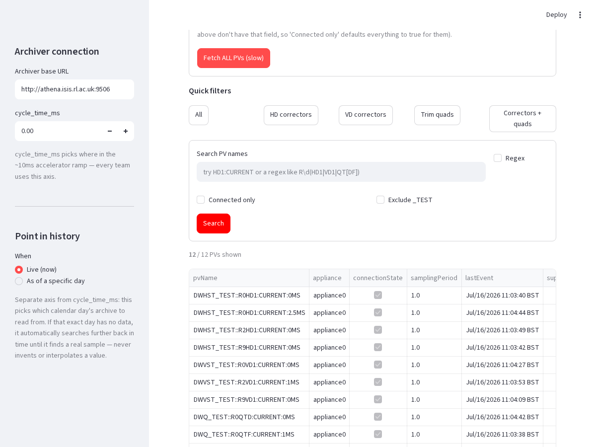

# ISIS RCS Synchrotron — Optics Modeling & EPICS Archiver Bridge

[](https://www.python.org/)
[](https://threejs.org/)
[](https://streamlit.io/)
[](https://epics-controls.org/)
[](https://mad.web.cern.ch/mad/)

> **Interactive 3D particle accelerator visualization, real-time EPICS archiver data pipeline, and accelerator optics backend for the ISIS Rapid Cycling Synchrotron (800 MeV proton synchrotron).**


---

## Placement Context

This project encompasses key engineering deliverables developed during a **1-week Work Experience Placement** with the **Accelerator Controls / EPICS Archiver Team** at the **STFC ISIS Neutron and Muon Source** ([Rutherford Appleton Laboratory](https://www.isis.stfc.ac.uk/), July 2026).

The work focused on bridging live accelerator control data into a modular optics simulation environment, optimizing large-scale telemetry search tools, and building physically accurate 3D WebGL visualizations of the synchrotron lattice.

---

## Featured Deliverables & Contributions

### 1. Live EPICS Archiver REST Bridge (`src/optics_gui/io/`)
* **Real-time Data Ingestion:** Built Python client modules connecting to the facility's EPICS archiver REST API (`/glob`, `/getPVStatus`, `/data`) to pull live machine state data across the ~10 ms synchrotron acceleration ramp.
* **Physics & Magnet Ingestion:** Automated retrieval and parsing of trim-quadrupole settings, horizontal/vertical corrector currents, beam position monitor (BPM) readbacks, and harmonic tune programmes.
* **API Verification & Edge-Case Handling:** Tested documented internal endpoint behaviors against the live archiver, corrected inaccuracies in API documentation, and implemented robust fallbacks for unarchived or missing test-rig channels.

```python
from optics_gui.io import (
    archiver_fetch_value,
    get_corrector_settings,
    get_harmonic_tunes,
    get_requested_tune,
)

# Pull live corrector settings and tune programme for a cycle time
corrector_data = get_corrector_settings(cycle_time_ms=5.0)
harmonic_tunes = get_harmonic_tunes(cycle_time_ms=5.0)
```

---

### 2. 40,000+ Process Variable Search Engine (`web/pv_search.html`)
* **The Bottleneck:** An existing process variable lookup covering 40,000+ PVs suffered from ~5-second latency on every keystroke, freezing the interface.
* **The Solution:** Vectorised the parsing pipeline with Pandas, introduced smart input debouncing, and cached repetitive regex normalisation routines.
* **Result:** Achieved instantaneous, fluid keystroke filtering across the entire 40k+ variable database.


---

### 3. Interactive 3D WebGL Synchrotron Simulator (`web/isis_synchrotron_3d.html`)
* **Lattice-Accurate Geometry:** Built a Three.js / WebGL 3D model of the synchrotron generated from **real MAD-X lattice dipole bend angles** rather than an idealized circular ring.
* **Features:**
  * Interactive camera orbits and superperiod inspection (Superperiods 0 through 9).
  * Real-time beam path trajectory and animated particles synchronized to the 50 Hz machine cycle.
  * Standalone, zero-install HTML5 application capable of running locally in any modern browser.


---

### 4. Live Streamlit Archiver Bridge (`apps/archiver_live_app.py`)
* **Live EPICS Pipeline & Status Ledger:** Directly integrates the REST bridge (`epics_archiver_client.py` and `epics_live.py`) to stream real telemetry into the optics computation core.
* **Working Tabs & Interactive Diagnostics:**
  * **Architecture & Status:** Visualises real-time data movement from Athena archiver endpoints through to closed-orbit/tune GUIs.
  * **PV Search:** Performs instant regex filtering, magnet family parsing, and CSV exporting across thousands of PV records.
  * **BPM Geometry & Orbit:** Integrates MAD-X TWISS lattice execution across all 36 beam position monitors.

| Architecture & Data Movement | Active PV Search & Magnet Parsing |
|:---:|:---:|
|  |  |

| MAD-X TWISS 36-BPM Geometry Preview |
|:---:|
|  |

---

## Accelerator Optics Architecture

The repository provides a modular backend for modeling the beam dynamics and optics of the ISIS Rapid Cycling Synchrotron:

```text
isis-rcs-optics/
├── src/
│   └── optics_gui/
│       ├── io/                    # EPICS Archiver REST client & data ingestion
│       │   ├── epics_archiver_client.py
│       │   ├── epics_live.py
│       │   ├── measurements.py
│       │   └── archives.py
│       ├── cycle_time.py          # Relativistic beam ramp & kinematics (0-10ms)
│       ├── machine_state.py       # Machine state dataclasses & magnetic overrides
│       ├── madx_model.py          # MAD-X / cpymad lattice execution wrapper
│       ├── orbit_correction.py    # Closed-orbit correction (COCU-style algorithm)
│       ├── tune_matching.py       # Tune matching & harmonic quadrupole tuning
│       ├── envelope.py            # Beam envelope & RMS emittance calculation
│       ├── aperture.py            # Mechanical aperture clearance margins
│       └── snapshot.py            # Whole-system machine state snapshot integration
├── web/
│   ├── isis_synchrotron_3d.html   # 3D WebGL Synchrotron simulation (Three.js)
│   └── pv_search.html             # 40,000+ Process Variable search tool
├── apps/
│   └── archiver_live_app.py       # Streamlit live archiver bridge application
├── assets/
│   └── screenshots/               # High-res UI & 3D renders
├── docs/                          # Placement notes, EPICS reference, and guides
└── tutorials/                     # Step-by-step interactive Jupyter notebooks
```

---

## Visual Gallery

| 3D Synchrotron Ring | Superperiod Layout |
|:---:|:---:|
|  |  |

| Live Operator UI | 3D Interactive Canvas |
|:---:|:---:|
|  |  |

---

## Quickstart Guide

### 1. Running the 3D WebGL Synchrotron Simulator
No dependencies required — open directly in any browser:
```bash
# Linux
xdg-open web/isis_synchrotron_3d.html

# macOS
open web/isis_synchrotron_3d.html

# Windows
start web/isis_synchrotron_3d.html
```

### 2. Running the 40k+ PV Search Tool
```bash
xdg-open web/pv_search.html
```

### 3. Running the Streamlit Archiver Bridge
```bash
# Create and activate virtual environment
python3 -m venv .venv
source .venv/bin/activate

# Install dependencies
pip install -r requirements.txt
pip install -e .

# Launch the app
streamlit run apps/archiver_live_app.py
```

---

## Technical Stack
* **Languages & Runtimes:** Python 3.10+, JavaScript (ES6+), HTML5/CSS3
* **Graphics & Visualization:** Three.js, WebGL, Matplotlib, Plotly
* **Scientific Computing:** NumPy, Pandas, cpymad (CERN MAD-X interface)
* **Web & UI Frameworks:** Streamlit
* **Controls Systems:** EPICS (Experimental Physics and Industrial Control System) Archiver Appliance REST API
